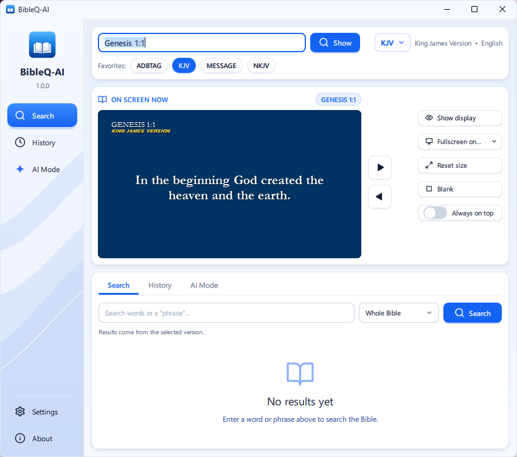

# BibleQ-AI

Version 1.0.0 — by Anthony Chavez (Dallas, Texas)

BibleQ-AI is a desktop app for projecting Bible verses on any screen, in the translations you choose, with a built-in AI study assistant. Ask a question in your own words and BibleQ-AI uses retrieval-augmented generation (RAG): the bge-m3 embedding model searches your Bibles by meaning, not just keywords, and Google Gemini writes an answer grounded in those passages, with every verse cited.



*The BibleQ-AI app.*

## Setup (Windows)

1. Install **Python 3.10+** from python.org. During setup, tick "Add python.exe to PATH".
2. Double-click **`run.bat`**. The first time, it creates a virtual environment (`.venv`) and installs
   PySide6, which takes about a minute.
3. On the welcome screen (shown when no Bibles are installed yet), click **Import Bible Version…** and choose
   one or more Bible files (`.sqlite` or `.db3`). BibleQ-AI converts them into its own `data\` folder; the
   original files are never changed. (Same as **Settings → Import Bible version…** later.)

### AI Mode setup (optional)

```bat
.venv\Scripts\python -m pip install -r requirements-ai.txt
```

This installs PyTorch, sentence-transformers, ChromaDB, the language detector, Google's Gemini library
and keyring (several GB). Then see [AI Mode](#ai-mode) below.

### Standalone .exe

Run **`build_exe.bat`**. It builds `dist\BibleQ-AI\BibleQ-AI.exe` (no Python needed on the target PC) and
copies the `data\` folder next to it. Start the program from `dist\BibleQ-AI\`, not from `build\`.

To keep the .exe small, it **does not include meaning-based search** (PyTorch, bge-m3, ChromaDB).
In this .exe, AI Mode finds verses by keyword and Gemini still writes the answers.

**Full .exe with meaning-based search:** run **`build_exe_full.bat`** instead. It installs the AI
packages if needed and builds `dist-full\BibleQ-AI\BibleQ-AI.exe` with PyTorch, sentence-transformers,
ChromaDB, the language detector and Gemini included, then copies the whole `data\` folder next to it
(Bibles, index and the bge-m3 model, about 4–6 GB in total). At the end it runs the new exe once with
`--selftest` and shows whether every AI part works inside it. Copy the whole `dist-full\BibleQ-AI`
folder to use it on another PC; no Python or installing is needed there.

## Using it

The sidebar on the left switches between **Search**, **History** and **AI Mode** (also available as
tabs), and has **Settings** and **About** at the bottom. On the right are the reference box and version
picker, the **On screen now** preview with the display controls, and the selected tab. The verse
itself shows in the separate display window. Everything scales with the window size.

**Typing references.** Book names work in English, Tagalog and Spanish, full or abbreviated:

```
Juan 3:16    jn 3:16    John 3:16-18    Mat 5:3-6:4    1 pe 5:7    I Pedro 5:7
Awit 23      Salmos 23:1    psalm 23    Jude 3
3:17   (same book)        18   (same chapter)
```

**Keyboard (main window)**

| Key | Action |
|---|---|
| Enter | Show the typed reference |
| PgDn / Ctrl+→ / Alt+→ | Next verse |
| PgUp / Ctrl+← / Alt+← | Previous verse |
| Ctrl+K | Choose version |
| Ctrl+1…9 | Switch to favorite version 1–9 |
| Ctrl+F | Search text |
| Ctrl+L / Esc | Go to the reference box |
| Ctrl+B | Blank screen |
| Ctrl+D | Show/hide display |
| F11 | Display fullscreen on/off |

**Keyboard (display window):** → ↓ Space for next, ← ↑ for previous, F11/F/double-click for fullscreen,
Esc to return to a window, B to blank. If you start typing on the display, the main window comes up
with the reference box ready. Right-click the display to choose a screen or always-on-top. The
verse window is always borderless (no title bar); drag it anywhere to move it.

**Resizing the display window.** Drag one of its four corners: width and height change together, so
the verse window keeps its shape. The sides can't be dragged on their own. **Reset size** (in
*On screen now*, tooltip "Reset to Default") makes it a quarter of the screen, in the shape of the
background image.

**Search** looks in the selected version. Every word must appear (so `love` also finds `loved`), and
accents don't matter. Put an exact phrase in "quotes". Verses that contain your words as a phrase are
listed first.

**Settings → Import Bible version…** adds one or more Bible versions from `.sqlite` or `.db3` files
or versions converted by BibleQ-AI on another PC. Each file
becomes a new version; the original files are only read, never changed. A file that is already in
the library is skipped. To use a new version in AI Mode, tick it in **Settings → AI Mode Settings**
and click **Refresh Index**.

**Settings → Appearance** sets the font, colors, background image or color, text size, margins and whether the
reference and version name show (top-left of the display). The preview stays visible while you
change them.

## AI Mode

AI Mode answers questions about the Bible in any language, using only the Bible versions you choose
(Ang Dating Biblia and King James Version by default).

How an answer is made:

1. **Plan the search.** Gemini names the passages a Bible teacher would look up for the question (and
   rewrites follow-up questions so they stand on their own). Turn this off in *Settings → Search tuning*.
2. **Find passages (on this computer).** Gemini's suggestions are read from your own Bibles, together with
   what BibleQ-AI finds itself: exact references (e.g. "Romans 8:28"),
   keyword search, and meaning-based search with the **BAAI/bge-m3** model, which also matches across
   languages (an English question can find Tagalog verses).
3. **Write the answer (Google Gemini).** Only your question and the passages found are sent to Gemini.
   It must answer in the language you asked in and cite only those passages. Any citation that
   doesn't match a found passage is removed, so BibleQ-AI never shows a reference it didn't retrieve.
4. **Check it.** Citations in the answer are links: click one to show that verse on the display.
   **Compare** shows the same verse in every installed translation.

Without an API key, without internet, or when the free quota is used up, AI Mode still answers with
the passages it found.

**First-time setup**

1. Install the AI components (see [Setup](#ai-mode-setup-optional)).
2. **AI Mode → Settings → Embedding model:** click **Download** next to BGE-M3 (about 2.3 GB, once).
3. **Build Index.** This embeds every verse of the selected versions (about 45 minutes per version).
   It can be cancelled and continues where it left off. Later, **Refresh Index** only processes
   Bibles that are new or changed.
4. Get a free Gemini API key at [aistudio.google.com](https://aistudio.google.com).
5. In **AI answers — Google Gemini**, click **Unlock to edit**, paste the key, click **Save**, then
   **Lock**. The section stays locked so the key and model can't be changed or removed by accident.
6. Click **Test Connection**. If the default model (`gemini-3.8-flash`) isn't available to your key,
   click **Scan Available Models** and choose one.

**Speed.** The verses appear as soon as they are found (usually under a second), and Gemini's answer
appears word by word as it is written. While Gemini hasn't written anything yet, or pauses, the chat
shows *Gemini is thinking…*. The Biblical references under each answer start collapsed; click
**Show Biblical references** to open them. Each answer ends with how long each step took. The search
engine (bge-m3 and the language detector) loads in the background when BibleQ-AI starts, so the first
question doesn't wait for it.

**Chat window.** Click **Pop out ⧉** to open the chat in its own window, the same size as BibleQ-AI and
right beside it. It follows the main window when you move or resize it. **Dock back** returns it to
the AI Mode tab.

**Which Bibles are indexed.** *Bibles used by AI Mode* lists only the checked versions. Type a name or
language in the box, or click **Show all**, to add another one, then click **Refresh Index**.

**Your API key** is stored in Windows Credential Manager (service "BibleQ-AI"), never in BibleQ-AI's
files or logs.

**Command line** (useful for long indexing runs):

```bat
.venv\Scripts\python -m digital_bible.ai.cli status
.venv\Scripts\python -m digital_bible.ai.cli build
.venv\Scripts\python -m digital_bible.ai.cli search "What does the Bible say about forgiveness?"
.venv\Scripts\python -m digital_bible.ai.cli compare "John 3:16"
```

## The data folder

Everything BibleQ-AI creates lives in `data\`, which is **not in git** (some translations, such as NIV
and ESV, are copyrighted):

```
data/
  catalog.sqlite     list of installed versions
  bibles/            converted Bibles (one .sqlite per version)
  backgrounds/       background images
  index/             AI Mode keyword index + ChromaDB vectors + indexing log
  models/            downloaded embedding models (bge-m3 ≈ 2.3 GB)
  settings.json      your settings (favorites, appearance, window positions, AI options)
  bibleq-ai.log       error output when started with run.bat
```

**Moving to another PC.** Clone the project, run `run.bat` once, install `requirements-ai.txt`, and copy
the whole `data\` folder from the old PC (close BibleQ-AI first). The index and model come with it, so
nothing needs to be imported, downloaded or embedded again. Copying is safe even if file dates change:
BibleQ-AI compares file contents, not dates. The Gemini API key is not in `data\`, so enter it again on
the new PC. Window positions from a different monitor setup are moved back onto the screen
automatically.

## Project layout

```
digital_bible/
  app.py             starts the app
  importer.py        decrypts + converts the old Bibles/*.db3 (or single .sqlite/.db3 files) into data/
  library.py         versions, verses, navigation, search
  reference.py       reference parser ("jn 3:16" -> John 3:16)
  canvas.py          draws a slide (shared by the display and the preview)
  display_window.py  the audience window
  settings.py        data/settings.json
  qml/               the new interface (Main.qml, pages/, components/)
  qml_ui/            Python side of the interface (controller.py, ai_controller.py, chat_model.py)
  selftest.py        BibleQ-AI.exe --selftest: checks AI Mode inside a built .exe
  ai/
    sources.py       reads the Bible databases for indexing
    keyword_index.py SQLite FTS5 keyword index
    embeddings.py    bge-m3 / e5 embedding models (download + encode)
    vector_store.py  ChromaDB vector storage
    indexer.py       build / refresh / cancel / resume the index
    retriever.py     hybrid search (references + keywords + meaning)
    language.py      detects the question's language
    generator.py     Gemini client, grounded prompt, citation checking
    cli.py           command-line tool
assets/              app icon (bibleq-ai.ico / .png / .svg)
tests/               pytest tests (most need an imported data/ folder)
run.bat              start BibleQ-AI (creates .venv the first time)
build_exe.bat        build the small dist\BibleQ-AI\BibleQ-AI.exe (keyword search in AI Mode)
build_exe_full.bat   build the full dist-full\BibleQ-AI\BibleQ-AI.exe (with meaning-based search)
requirements.txt     core: PySide6
requirements-ai.txt  AI Mode packages
```

Run the tests with:

```bat
.venv\Scripts\python -m pip install pytest
.venv\Scripts\python -m pytest tests
```
